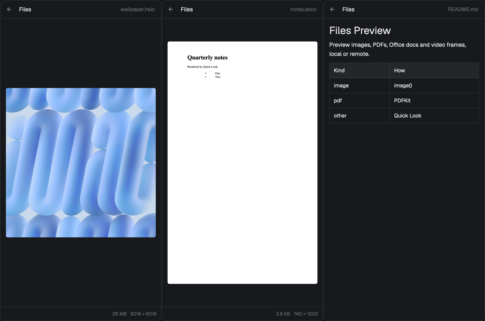

# herdr-files-preview

A [Herdr](https://herdr.dev) mod: Herdr's Files panel with Quick Look-style previews, for files on this Mac and on your other machines.



- **Previews**: images (PNG, JPEG, GIF, WebP, SVG, HEIC, TIFF; huge photos scaled), PDFs page by page, Office/iWork documents, video and audio frames through macOS Quick Look, rendered markdown, and code.
- **Remote files**: a space on another machine previews the same way. Files come through herdr-core in 2 MB chunks, with progress in the panel, so no ssh keys or `scp` are needed. Cached by path, mtime and size.
- **Right-click**: Quick Look, Open, Open in VS Code, Download to Downloads, Reveal in Finder, Copy Path.

## Install

1. Copy `mods/files-preview/` into `~/.config/herdr-app/mods/`.
2. Check it: `herdr-app check ~/.config/herdr-app/mods/files-preview`
3. Put it in your layout. With Herdr's default layout:

   ```sh
   herdr-app do layout.clone '{"name":"main","as":"main-preview"}'
   sed -i '' 's/"mod": "files"$/"mod": "files-preview"/' ~/.config/herdr-app/layouts/main-preview.json
   ```

   The Files button in the tab bar now opens this panel. `ctrl-shift-l` switches layouts back.

Or open it as a file viewer beside a terminal:

```sh
herdr-app do pane.split '{"direction":"right","mod":"files-preview","props":{"file":"README.md"}}'
```

## What it runs

It runs local programs (`sh`, `stat`, `dd`, `sips`, `qlmanage`, `osascript`, `open`, `pbcopy`, `code`) and `hc exec` on the machine of the focused space. It writes only to `~/.config/herdr-app/data/files-preview-cache/` (pruned to 200 files / 500 MB) and, when you choose Download, to `~/Downloads`. No network access beyond herdr-core.

## Limits

- PDF, Quick Look, Open, Reveal and HEIC need macOS. Elsewhere images, markdown and text still preview.
- Videos show one frame. Office documents show their first page (Quick Look in the menu shows all of it).
- Remote previews stop at 50 MB; Download has no limit.
- Opening a remote file in a local app opens a copy; edits don't go back to the machine.

## Credits

Built on the `files` mod shipped with [herdr-app](https://github.com/herdrdev/herdr-app) (Apache-2.0). The menu follows the pattern of `files-open-with` in [VladTemp27/herdr-orca](https://github.com/VladTemp27/herdr-orca). See [RECIPE.md](RECIPE.md) to rebuild it from scratch.

## License

Apache-2.0. See [LICENSE](LICENSE) and [NOTICE](NOTICE).
