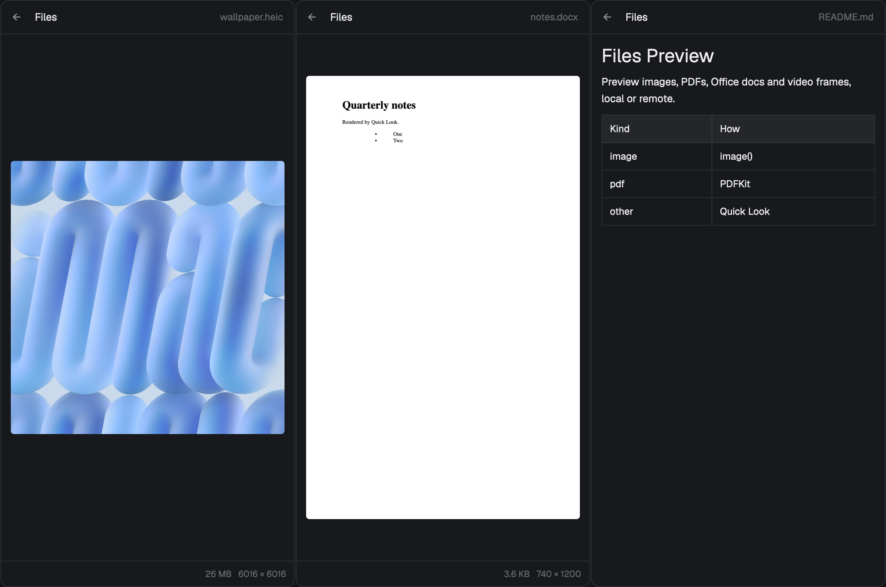

# Files Preview

Herdr's Files panel, with Quick Look-style previews. Click a file in the tree and the panel shows it: photos (HEIC and huge images included), PDFs page by page, Word/Excel/Keynote/video thumbnails through macOS Quick Look, rendered markdown, and code. It works the same for a space on another machine: the file is fetched through herdr-core, no ssh setup needed. Right-click any file for Quick Look, Open, Open in VS Code, Download to Downloads, Reveal in Finder and Copy Path.

## What you see

- One panel, same shape as the shipped Files: a 42px header (`←` back, "Files", the shown file or folder name on the right in `dim`, 12px), then either the tree or one file's preview. Colors all come from `theme()` (`background`, `border`, `foreground`, `muted`, `dim`, `hover`, `selected`, `popover`).
- Tree: 28px rows, 18px indent per level, chevron + folder/file icon + name, git marks (`A` ansi2, `M` blocked color, `D`/`U` ansi1) on the right. Unchanged from Herdr's Files.
- Preview area by kind:
  - image: fitted inside the area, aspect kept, never upscaled, 4px corners; footer shows size and the original's `W × H`.
  - pdf: one page rendered at 1600px long side; footer has `‹ p / N ›` buttons.
  - quicklook (docx, xlsx, pptx, pages, numbers, key, rtf, mp4, mov, mp3, zip, psd, ...): Quick Look's 1200px thumbnail, fitted like an image.
  - markdown: `TextView.markdown`, scrollable (tables, code blocks).
  - text/code: the read-only `Editor` with syntax colors, 1 MiB cap.
- While a remote file is fetched: `Fetching 12.0 / 34.5 MB`.
- While a menu action fetches or downloads: a strip at the panel's bottom, `Downloading big.bin   6.0 MB / 30 MB`, one row per job, 12px `muted`.
- Errors replace the preview in `dim`: `No preview`, `Too large to preview` (remote over 50 MB), `This file is no longer available`, `Binary file · no text preview`.
- Right-click menu: a 220px popup, file name header in `dim` 11px, 30px rows, `selected` for the keyboard row.

## How it behaves

- The panel follows the focused pane's folder and machine, like Herdr's Files. Back (`←`) returns to the tree.
- Click a file: the preview loads. Selecting another file cancels the old one's result (a request token), so a slow fetch never overwrites a newer choice.
- Remote files are fetched once per (machine, path, mtime, size) into the cache; reopening is instant, and a changed file gets a new cache entry.
- Right-click a row, the header, or the preview to open the menu. Up/Down/Enter/Esc work in it. Items by case:
  - Quick Look (`qlmanage -p`) and Open (`open`): macOS; a remote file is fetched first.
  - Open in VS Code: local files only, when `code` or the app is installed (a remote file would open the cache copy, and edits would not reach the machine).
  - Download to Downloads: remote files; never overwrites (`name (1).ext`); toast with the path.
  - Reveal in Finder: local files. Copy Path: always (the path on its own machine).
- `props.file` (relative to the folder, or absolute) opens that file directly: `pane.split {direction:"right", mod:"files-preview", props:{file:"README.md"}}` is a file viewer.
- Agent status is not shown here (no agent display in this mod).

## Built from

- `mods/files-preview/`, place `none`. Use it by pointing a layout block at it. With Herdr's default layout: `herdr-app do layout.clone '{"name":"main","as":"main-preview"}'`, then in `layouts/main-preview.json` change the block `{"id":"files", "content":{"mod":"files"}}` to `"mod":"files-preview"`. The tab bar's Files button keeps working (it toggles the stack child by id `files`).
- `main.js`: the tree (from Herdr's `files` 0.1.14), the request token, `props.file`, right-click wiring. When `props().role === "menu"` the same mod renders the popup instead.
- `fetch.js`: the only local-vs-remote boundary. `materialize(source)` returns a local file: local paths as they are, remote ones copied in 2,000,000-byte chunks with `hc exec --on <machine> dd ... >> file.part` run locally, then `mv`. Concurrent requests for one cache key share one fetch. `stageImage` copies, converts (heic/tiff via `sips`) or shrinks (over 2048px via `sips -Z 2048`) into the cache. `downloadToDownloads`. Cache pruned to 200 files / 500 MB.
- `preview.js`: `KINDS` table (extension → image | pdf | markdown | text | quicklook), one preview value `{state: idle | loading | ready | error}`, the PDF page renderer (JXA: PDFKit page drawn into a CGBitmapContext, PNG), `qlmanage -t -s 1200` for quicklook.
- `menu.js`: `MENU`, a list of `{id, label, verb?, when(entry, ctx), run(entry, progress)}`, and the popup view (`openOverlay({mod:"files-preview", kind:"popup", width:220, props:{role:"menu", entry, from, ids}})`). Choosing an item writes shared `files-preview.request` `{to: from, seq, id, entry}` and closes the popup; the panel whose random `uid` equals `to` runs the item in its render-time `take()` and shows the progress strip.
- Herdr API: `spaces`, `panes`, `focused`, `exec` (with `on`), `readTextFile`, `watchFolder`, `openOverlay`, `closeOverlay`, `notify`, `props`, `theme`, `window`, `appHome`, `home`. Programs: `sh`, `stat`, `dd`, `hc`, `mv`, `cp`, `sips`, `qlmanage`, `osascript`, `open`, `pbcopy`, `code` (optional), `git`.

## Watch out

- `image()` only draws paths relative to the app home (`~/.config/herdr-app`). Absolute and `~` paths draw nothing. Hence the cache at `data/files-preview-cache/`.
- Never write the cache inside `mods/files-preview/`: every write hot-reloads the mod.
- A popup that closes itself cancels its own tasks after their first `await`. Running a download from the menu popup silently stops before any byte arrives. Hand the work to the long-lived panel (shared request) instead.
- Herdr never forgets an image path it loaded, even one that failed. Give every different picture a new file name (the cache name includes mtime and size; shrunk copies end in `.img2048.png`).
- Images over roughly 2048px on a side (a 6016×6016 HEIC as a 57 MB PNG) draw blank. Shrink them.
- `exec` stdout is a UTF-8 string and `hc exec` keeps only the first 8 MB of output, so binary must go to a local file through a shell redirect, in chunks. At about 1 MB/s, 2 MB chunks keep progress moving.
- ssh/scp can't be assumed (jump hosts with passwords); herdr-core's connection always exists.
- `PDFPage.thumbnailOfSize` is not callable from JXA; draw the page into a bitmap context.
- `qlmanage -t` can hang on files no generator understands; it has a 15 s timeout.
- `cx.notify()` is refused during render, including in a `cx.spawn` before its first `await`; `on_size_change` can fire during render.
- `fs/promises` has no `stat`; sizes come from the `stat` program (GNU and BSD forms).
- macOS only for PDF, Quick Look, Open, Reveal, HEIC. Elsewhere, images, markdown and text still preview.
- Videos show one frame; there is no video element. Multi-page Office documents show their first page.
- Opening a remote file in a local app opens a read-only copy; edits don't go back.

## Done when

- `herdr-app check mods/files-preview` passes.
- In a local folder: a PNG and a JPEG show fitted with correct `W × H`; a 6016×6016 HEIC shows (from the 2048px copy) with `6016 × 6016` in the footer; a 2-page PDF shows page 1 and `‹ 1 / 2 ›`, `›` shows page 2; a .docx shows its Quick Look page; a .md shows a rendered table.
- In a space on another machine: the same PNG shows identical pixels; a 9 MB file shows `Fetching … MB`, then the cache file's md5 equals `hc exec --on <m> md5sum <file>`.
- Right-click a remote file → Download to Downloads: the menu closes, the panel shows `Downloading name  x MB / y MB`, and the file lands in `~/Downloads` with the remote md5 (checked with a 30 MB file); a second download becomes `name (1).ext`.
- Right-click a local file shows Quick Look, Open, (Open in VS Code), Reveal in Finder, Copy Path; Quick Look opens the system panel.
- `herdr-app status` shows no files-preview error.
